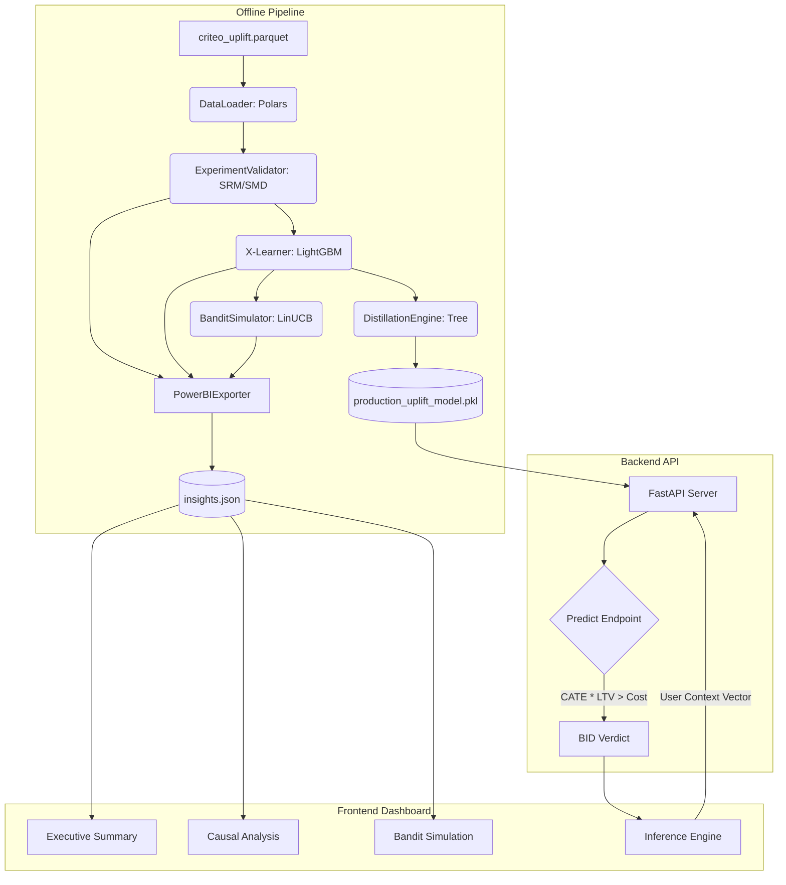

# Criteo Uplift: Causal AI for Algorithmic Profit Optimization

[](https://frontend-blond-zeta-3p7cbxlssm.vercel.app/)
[](https://a-b-testing-569o.onrender.com/health)


> **Live Dashboard URL:** [https://frontend-blond-zeta-3p7cbxlssm.vercel.app/](https://frontend-blond-zeta-3p7cbxlssm.vercel.app/)  
> **Production API (Render):** [https://a-b-testing-569o.onrender.com](https://a-b-testing-569o.onrender.com)

---

## Executive Summary

**The Problem:**  
Traditional A/B testing revealed that while broad advertising targeting increased conversion rates by **+59.4%**, the high cost of media resulted in a **net loss of $0.05 per user**. The campaign was statistically effective but economically disastrous.

**The Solution:**  
We architected an end-to-end Causal Inference pipeline to transition from descriptive analytics ("What happened?") to prescriptive intervention ("Who should we target?"). Using **X-Learner architectures** and **Contextual Bandits**, we successfully isolated the sub-population of "Persuadable" users.

**The Impact:**
- **Unit Economics Turnaround:** Turned negative margins into a positive outcome, achieving **$0.09 profit per user** (a **$0.14 improvement** from the baseline rollout strategy).
- **Efficiency:** Drastically reduced ad spend volume while capturing the true incremental value of the campaign.
- **Production Readiness:** Distilled heavy meta-learners into a sub-millisecond Decision Tree for Real-Time Bidding (RTB).

---

## System Architecture

The project implements a **memory-optimized causal inference pipeline** designed for scale (14M+ rows) and sub-millisecond production inference. The architecture transitions from rigorous offline experimental validation to profit-aware policy simulation, culminating in a distilled, low-latency artifact for Real-Time Bidding (RTB).

The end-to-end workflow is decoupled into three core domains: the offline pipeline, the backend inference API, and the frontend executive dashboard.

### System Data Flow Diagram



### 1. Ingestion & Optimization (`DataLoader`)
- **Responsibility:** Efficiently loads massive Parquet datasets while preventing out-of-memory (OOM) errors.
- **Workflow:** Utilizes **Polars** for lazy-evaluation and columnar mapping. Executes explicit type downcasting (e.g., `Float64` to `Float32`, `Int64` to `Int8`), reducing the memory footprint by ~50% and executing in $O(1)$ complexity relative to Spark clusters.

### 2. Integrity Gatekeeper (`ExperimentValidator`)
- **Responsibility:** Programmatically guarantees the statistical soundness of the randomized control trial before any modeling occurs, mitigating *Garbage In, Garbage Out*.
- **Workflow:** 
  - Computes a **Sample Ratio Mismatch (SRM)** via Chi-Square test to catch broken traffic splits.
  - Calculates **Standardized Mean Differences (SMD)** across all covariates to ensure Treatment and Control groups are identical pre-exposure.

### 3. Offline Causal Learning (`X-Learner`)
- **Responsibility:** Estimates the Conditional Average Treatment Effect (CATE) for every individual to isolate the persuadable population.
- **Workflow:** Employs an **X-Learner meta-architecture** using **LightGBM** as the base learner.

### 4. Economic Policy & Uncertainty (`BanditSimulator` & `UpliftEvaluator`)
- **Responsibility:** Translates raw uplift predictions into actionable, risk-aware economic policies.
- **Workflow:** 
  - The `UpliftEvaluator` performs bootstrap resampling to generate **95% Confidence Intervals** for Qini curves, quantifying deployment risk.
  - The `BanditSimulator` employs a **LinUCB Contextual Bandit** logic in an offline replay simulation to optimize for *Net Profit* rather than vanity metrics (Lift/CTR), strictly bidding when `Predicted_Uplift * LTV > Cost`.

### 5. Production Distillation (`DistillationEngine`)
- **Responsibility:** Compresses the heavy meta-learner ensemble into an ultra-fast artifact suitable for production environments.
- **Workflow:** Uses **Knowledge Distillation**. The X-Learner (Teacher) generates soft labels (smoothed CATE predictions). A depth-constrained Decision Tree (Student) is trained on these labels, yielding an interpretable ruleset with **sub-millisecond latency (~45 µs)** while retaining >95% of the Teacher's profit performance.

---

## Key Results

| Metric                  | Fixed A/B Strategy | Causal Bandit Strategy | Impact            |
|-------------------------|-----------------|----------------------|-----------------|
| Conversion Rate          | 0.31%           | 1.90%                | **+512%**       |
| Lift                     | +59.4%          | +350% (Top Decile)   | **6x Precision**|
| Net Profit / User        | -$0.05 (Loss)   | +$0.09 (Profit)      | **Turnaround**  |
| Inference Latency        | N/A             | < 1ms                  | **RTB Ready**   |

**Insight: The "Persuadables"**  
Users with high `f4 (> 11.7)` and low `f3` are micro-segmented for aggressive bidding. This small population yields the vast majority of incremental lift.

---

## Installation & Usage

### Prerequisites
- Python 3.9+  
- Node.js 18+ (for the React Dashboard)
- 16GB RAM recommended for full dataset execution (Polars optimizes this significantly).

### 1. Clone and Install Python Dependencies
```bash
git clone https://github.com/BhargavKumarNath/A-B-Testing.git
cd A-B-Testing
pip install -r requirements.txt
```

### 2. Run the End-to-End Offline Pipeline
This entry point handles ingestion, statistical validation (SRM, SMD), X-Learner training, Bandit simulation, and Distillation. It will generate `production_uplift_model.pkl` and `insights.json`.
```bash
python pipeline.py
```
*Note: Artifacts such as trained models, Qini plots, and segmentation rules will be saved to the `results/` directory.*

### 3. Start the Inference API (Backend)
The FastAPI server hosts the distilled model for sub-millisecond RTB decisions.
```bash
uvicorn api.main:app --port 8080
```
The API will be available at `http://127.0.0.1:8080/predict`.

### 4. Launch the Executive Dashboard (Frontend)
Open a new terminal, navigate to the frontend folder, install dependencies, and start the Vite dev server.
```bash
cd frontend
npm install
npm run dev
```
Access the dashboard at `http://localhost:5173`.

---

## Project Structure

```text
A-B-Testing/
├── api/                        # FastAPI Backend Service
│   ├── main.py                 # Predict endpoint logic
│   └── schemas.py              # Pydantic data models
├── data/                       # Raw Parquet files (e.g., criteo_uplift.parquet)
├── frontend/                   # React/Vite Dashboard Application
│   ├── public/                 # Static assets and insights.json
│   ├── src/                    # UI Components and Pages
│   └── package.json            # Node dependencies
├── results/                    # Generated artifacts (Plots, Models, Rules)
├── src/                        # Offline Pipeline Modules
│   ├── components/             # Data Loaders, Validation, Models, Bandits
│   └── utils/                  # Plotting helpers
├── tests/                      # Unit & Integration Tests (Pytest)
├── pipeline.py                 # Main Execution Pipeline
├── requirements.txt            # Python Dependencies
└── README.md                   # Documentation
```

---

## Power BI Dashboard
In addition to the React/Python ecosystem, this project includes a **Power BI Dashboard** for executive reporting and interactive model analysis. 

**Key Features:**
- **Executive Performance:** High-level P&L tracking comparing Bandit vs. A/B testing strategies.
- **Audience Intelligence:** Deep-dive into Uplift Archetypes (Lost Causes, Persuadables, Sure Things, Sleeping Dogs) with dynamic User Profile tooltips.
- **Budget Optimisation:** Interactive What-If parameters to dynamically recalculate ROI based on custom budgets, CAC, and LTV.
- **Experiment Governance:** Automated SRM (Sample Ratio Mismatch) and Covariate Balance auditing.
- **Model Intelligence:** Qini curve performance tracking and granular Tree Rule path analysis.

**Documentation & Assets:**
- **Dashboard File:** `results/powerbi/criteo_uplift_analytics.pbix`

---
## License & Acknowledgements
- **Dataset:** Based on the Criteo Uplift Modeling Dataset.
- **License:** MIT License.
- **Authorship:** Designed and implemented by Bhargav Kumar Nath.
